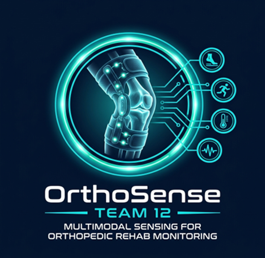
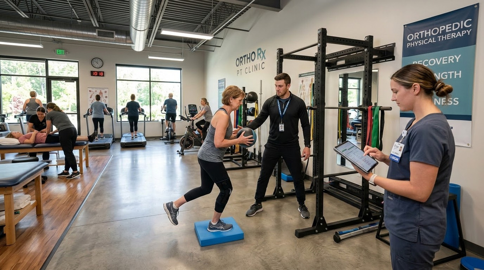
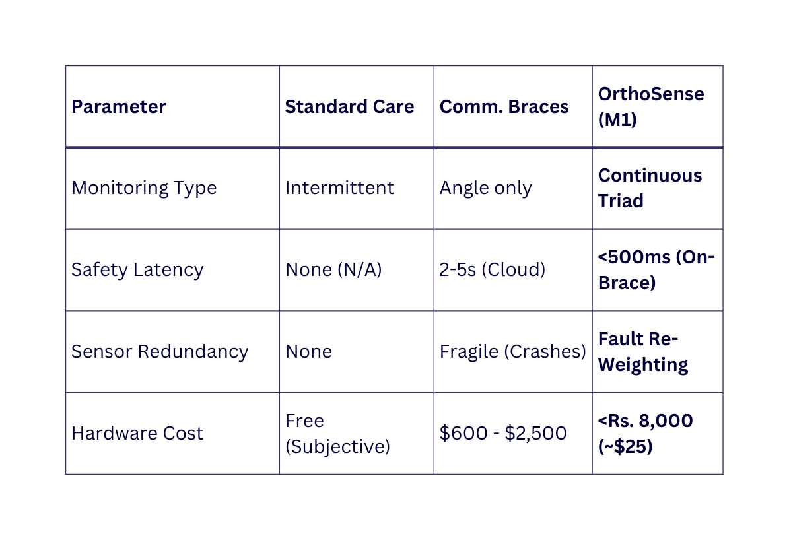
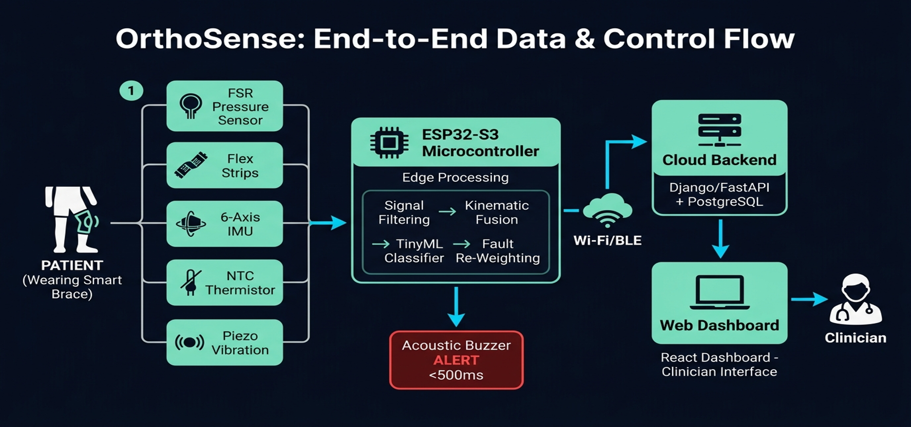
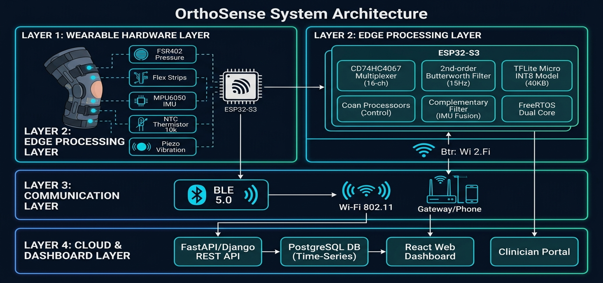
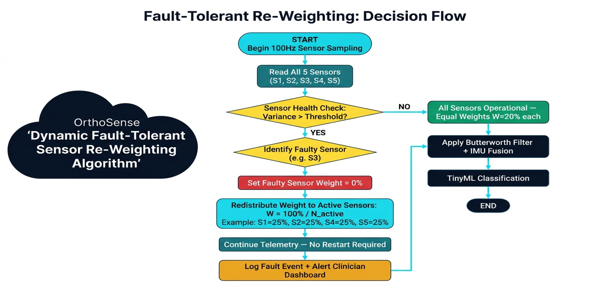
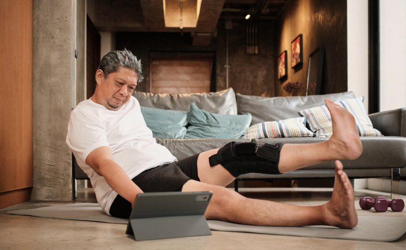
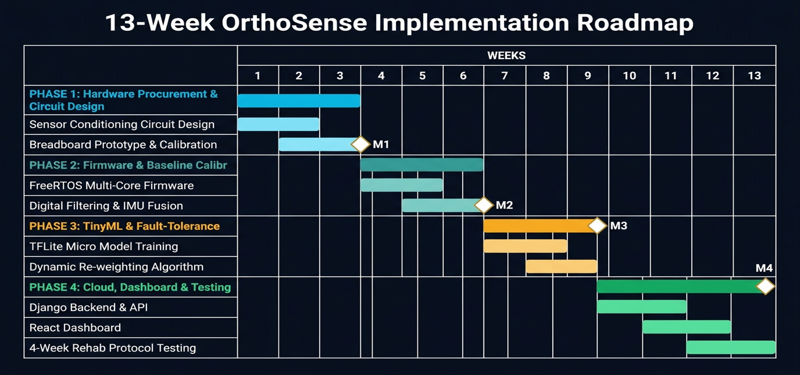

[comment]: # "This is the standard layout for the project, but you can clean this and use your own template"

# OrthoSense: Multimodal Sensing Framework for Orthopedic Rehab Monitoring

---

## Team
-  E/22/237, M.F.M. Minhaj Ali (Team Leader), [e22237@eng.pdn.ac.lk](mailto:e22237@eng.pdn.ac.lk)
-  E/22/032, K.D. Ashen (Product Owner), [e22032@eng.pdn.ac.lk](mailto:e22032@eng.pdn.ac.lk)
-  E/22/228, W.M.S. Manujitha (Developer), [e22228@eng.pdn.ac.lk](mailto:e22228@eng.pdn.ac.lk)
-  E/22/280, H.C.V. Perera (Developer), [e22280@eng.pdn.ac.lk](mailto:e22280@eng.pdn.ac.lk)

<!-- Image (photo/drawing of the final hardware) should be here -->

<!-- This is a sample image, to show how to add images to your page. To learn more options, please refer [this](https://projects.ce.pdn.ac.lk/docs/faq/how-to-add-an-image/) -->

#### Table of Contents
1. [Introduction](#introduction)
2. [Solution Architecture](#solution-architecture )
3. [Hardware & Software Designs](#hardware-and-software-designs)
4. [Testing](#testing)
5. [Detailed budget](#detailed-budget)
6. [Conclusion](#conclusion)
7. [Links](#links)

---

## Introduction

Orthopedic recovery following reconstructive knee surgeries (such as Anterior Cruciate Ligament (ACL) reconstruction, total knee arthroplasty, and complex articular fracture repairs) demands a lengthy **6 to 12-month recovery journey**. 

### The Real-World Clinical Problem

During the initial **2 to 4 weeks post-surgery**, the reconstructed graft undergoes critical neovascularization and cellular remodeling. During this fragile phase, joint stabilization is paramount: uncontrolled shear forces, compensatory torque, or premature joint hyperextension (>30° flexion in Week 1) can permanently stretch or rupture the graft, resulting in surgical failure and permanent joint instability.

In standard healthcare practice, significant barriers prevent continuous clinical oversight:
- **The 2–4 Week Recovery Blind Spot:** Patients perform more than 95% of their prescribed physical therapy exercises unassisted at home. In-clinic consultations occur only once every 2 to 4 weeks.
- **Inaccurate Patient Self-Reporting:** Surgeons rely on subjective patient self-recall, which exhibits **over 60% error rate**. Patients cannot accurately gauge joint degrees, contact force, or subtle compensatory limping.
- **Limitations of Current Braces:** Commercial smart braces are priced between **$600 and $2,500 USD**, track only single-axis joint angle, introduce dangerous 2–5 second cloud roundtrip latency, and freeze entirely when an analog sensor detaches.

  

### The Proposed Solution: OrthoSense

**OrthoSense** introduces an ultra-low-cost (~Rs. 8,870 LKR / ~$25 USD), multimodal wearable smart knee rehabilitation brace based on an **ESP32-S3** dual-core edge processor. The system bridges the post-surgical blind spot through four engineering innovations:
- **Continuous Multimodal Triad:** Concurrently tracks joint kinematics (6-axis IMU), contact pressure / quadriceps loading (FSR matrix), and localized thermal swelling index (NTC thermistors) alongside high-frequency shock detection.
- **Deterministic Edge Safety Trip:** On-device TinyML inference triggers immediate (<500ms) acoustic buzzer and vibration feedback whenever safety thresholds are breached—completely offline with zero cloud dependency.
- **Graceful Fault Tolerance:** Dynamic mathematical sensor re-weighting isolates disconnected, slipping, or saturated sensors in real time without firmware crashes or reboots.
- **Economical Academic Deployment:** Built under Rs. 8,870 LKR (~$25 USD), significantly lowering the barrier for accessible home rehabilitation.

### Solution Viability Benchmark

  

| Parameter | Standard Care | Commercial Smart Braces | OrthoSense (Team 12) |
| :--- | :--- | :--- | :--- |
| **Monitoring Type** | Intermittent (clinic visits every 2–4 wks) | Angle only (single IMU / potentiometer) | **Continuous Clinical Triad** (Angle + Pressure + Temperature) |
| **Safety Latency** | None (Post-injury clinical review) | 2–5 seconds (Cloud server roundtrip) | **<500 ms On-Brace Acoustic/Tactile Cut-Off** |
| **Sensor Redundancy** | None | Fragile (Firmware freezes on sensor fault) | **Dynamic Fault-Tolerant Re-Weighting Matrix** |
| **Hardware Cost** | Free (Subjective recall only) | $600 – $2,500 USD | **< Rs. 8,870 LKR (~$25 USD)** |

---

## Solution Architecture

### High-Level System Architecture & Data Flow

  

The OrthoSense data and control pipeline operates across a closed-loop system:
1. **Multimodal Sensing:** Embedded FSR sensors, flex strips, 6-axis IMU, NTC thermistors, and piezo impact sensors capture continuous biomechanical data at 1Hz to 100Hz.
2. **On-Chip Signal Conditioning & Fusion:** Signals pass through a 15Hz 2nd-order digital Butterworth low-pass filter and an attitude complementary fusion algorithm to obtain drift-free joint angles (<3° error).
3. **Local TinyML & Fault Tolerance:** The ESP32-S3 continuously runs dynamic sensor health checks and INT8 TinyML inference, classifying movement into normal activity, controlled exercise, or hazardous strain.
4. **Immediate Edge Intervention:** If an acute hyperextension, dangerous strain, or contact pressure breach (>80N) occurs, the on-brace active buzzer trips in **<500ms**, physically alerting the patient without waiting for cloud validation.
5. **BLE Uplink & Cloud Storage:** Compact 24-byte GATT packets stream over BLE 5.0 to a smartphone gateway, which buffers up to 72 hours of offline telemetry and uploads data via TLS 1.3 to the Django / PostgreSQL cloud backend.
6. **Clinician Telemetry Dashboard:** Physical therapists visualize live joint angle trajectories, repetition validity scores, and joint swelling indexes on a responsive React web interface.

### Layered System Organization

  

The system is organized into four modular layers:
- **Layer 1: Wearable Hardware Layer:** Neoprene sleeve with embedded FSR402 sensors, MPU6050 6-axis IMU, NTC thermistor array, piezo shock sensor, CD74HC4067 multiplexer, 16-bit precision ADC, 0.96-inch OLED display, and 18650 Li-ion battery pack with TP4056 BMS.
- **Layer 2: Edge Processing Layer:** ESP32-S3 microcontroller (240MHz dual-core Xtensa LX7 with PIE vector instructions, 8MB PSRAM). Core 0 executes sensor sampling and 15Hz digital filtering; Core 1 runs the FreeRTOS BLE stack, dynamic sensor re-weighting, and quantized TFLite Micro model (<40KB SRAM footprint).
- **Layer 3: Communication Layer:** Low-energy BLE 5.0 2M PHY uplink delivering 24-byte telemetry packets to a local mobile gateway/cache with 72-hour offline storage and Wi-Fi 802.11 fallback.
- **Layer 4: Cloud & Dashboard Layer:** Django / FastAPI backend service exposing REST and WebSocket endpoints, PostgreSQL / TimescaleDB encrypted time-series storage, and a React 18 clinician web portal.

### Distributed Control Decision Hierarchy

| Level | Decision Scope | Execution Node | Response Time | Action & Clinical Safeguard |
| :-: | :--- | :--- | :-: | :--- |
| **Level 1** | **Ultra-Fast Safety Trip** | ESP32-S3 Edge Node | **< 500 ms** | If knee angle exceeds prescribed weekly ROM limit (e.g. >30° in Week 1) or FSR contact force exceeds 80N, immediately sound buzzer and pulse vibration motor to stop movement. Zero cloud latency. |
| **Level 2** | **Adaptive Fault Tolerance** | ESP32-S3 Edge Node | **< 100 ms** | If sensor variance drops to zero (open circuit) or saturates (brace slip), mark node as unhealthy, re-weight healthy sensor matrix, and notify patient on OLED. |
| **Level 3** | **Exercise Repetition Validation** | Mobile Gateway App | **< 1 s** | Analyzes extension velocity and peak flexion angle. Counts valid repetitions and emits auditory coaching prompts for compensatory twisting. |
| **Level 4** | **Rehabilitation Protocol Progression** | Cloud Backend | **Weekly** | Analyzes 7-day adherence score (>85%) and thermal swelling index stability. Recommends advancing from Phase 1 (passive ROM) to Phase 2 (active sets). |

### Security & Privacy at All System Points

- **Edge Node Security:** Hardware Secure Boot and AES Flash Encryption prevent firmware tampering or intellectual property extraction.
- **Zero Plaintext PII on Brace:** The wearable node strictly transmits anonymous numerical sensor vectors and session tokens—no patient names, identification numbers, or clinical history are stored locally.
- **Encrypted Transmission:** BLE links utilize AES-128 pairing encryption and randomized private MAC addresses to thwart eavesdropping and location beacon tracking.
- **Cloud Infrastructure Security:** TLS 1.3 transport encryption with certificate pinning for all REST and WebSocket connections. Database tables utilize AES-256 storage encryption with anonymized GUID keys, meeting HIPAA and GDPR guidelines.
- **Role-Based Access Control (RBAC):** Orthopedic surgeons, physical therapists, and patients have strictly partitioned access views secured by JWT tokens. Every limit alteration is recorded in immutable audit logs.

---

## Hardware and Software Designs

### Multimodal Sensor Suite & Conditioning

The OrthoSense knee sleeve integrates five distinct sensing modalities:
1. **6-Axis IMU (GY-521 / MPU6050):** Placed across femur and tibia segments; sampled at 50Hz to calculate real-time joint flexion/extension angles.
2. **Force-Sensing Resistors (FSR402):** 3 thin-film sensors positioned over the patellar tendon, medial joint compartment, and lateral joint compartment (100g to 10kg dynamic force range, sampled at 20Hz).
3. **Thermal Swelling Index (NTC MF52 10kΩ Thermistors):** 4 high-precision (1%) thermistors sampled at 1Hz comparing bilateral peri-patellar temperatures against ambient temperature to quantify joint effusion and inflammation.
4. **Impact & Vibration Sensor (Piezoelectric):** 100Hz burst capture to detect joint clicking, abrupt stumbling, or mechanical shocks during ambulation.
5. **Signal Conditioning:** Signals route through a CD74HC4067 16-channel multiplexer into a 16-bit low-noise external ADC, filtering out thermal and ADC quantization noise.

### ESP32-S3 Edge Compute & Firmware Architecture

The edge compute engine leverages an **ESP32-S3 Nano development board** equipped with 8MB PSRAM and 240MHz Xtensa LX7 dual-core processing:
- **Core 0 Execution:** Dedicated to high-speed deterministic interrupt routines, reading the 16-bit ADC, executing the 2nd-order 15Hz digital Butterworth filter, and performing complementary kinematic fusion.
- **Core 1 Execution:** Runs the FreeRTOS BLE 5.0 GATT server stack, maintains a 500-sample circular ring buffer, evaluates sensor variance for fault tolerance, and executes the TFLite Micro inference kernel.

### Edge-AI Movement Classification (TinyML)

The local machine learning subsystem deploys a quantized **TensorFlow Lite for Microcontrollers (TFLite Micro)** model:
- **Model Footprint:** Fully quantized INT8 model occupying **less than 40KB of SRAM**, running in under 20ms using Xtensa Vector PIE instructions.
- **Movement States Classified:**
  1. *Normal Ambulation:* Controlled walking and stance phases.
  2. *Prescribed Rehabilitation Exercises:* Straight-leg raises, isometric quad sets, seated heel slides.
  3. *Hazardous Strain & Compensatory Biomechanics:* Knee hyperextension, excessive varus/valgus knee wobbling, abnormal loading rates.

### Dynamic Fault-Tolerant Re-Weighting Algorithm

  

To prevent catastrophic system freezes when sensors disconnect or slip during rigorous exercise sets, OrthoSense implements dynamic sensor re-weighting:
1. **Health Verification:** Over a 50-sample sliding window, variance $\sigma_i^2$ is evaluated:
   $$\sigma_i^2 = \frac{1}{N} \sum_{k=1}^{N} (x_i[k] - \bar{x}_i)^2$$
2. **Fault Isolation:** If $\sigma_i^2 < \epsilon_{min}$ (open-circuit/disconnected wire) or signal is permanently pegged to supply rail (saturation/sleeve slip), sensor $S_i$ is flagged as faulty.
3. **Mathematical Re-Weighting:** The faulty sensor's coefficient is set to $W_i = 0\%$. Total weight is redistributed equally among the $N_{active}$ operational sensors:
   $$W_k = \frac{100\%}{N_{active}} \quad (\text{e.g., from } 20\% \text{ across 5 sensors to } 25\% \text{ across 4 active sensors})$$
4. **Telemetry Continuity:** Exercise monitoring continues with zero MCU resets, while a diagnostic fault code is transmitted to the clinician dashboard.

### Cloud Telemetry Backend & Clinician Web Portal

- **Backend Architecture:** Built with Django / FastAPI and PostgreSQL / TimescaleDB, supporting high-throughput time-series ingestion and secure REST/WebSocket sessions.
- **Clinician Dashboard:** React 18 web interface providing clinicians with:
  - Real-time Range of Motion (ROM) curves and peak angle tracking.
  - 4-week rehabilitation milestone progress tracking against clinical benchmarks.
  - Automated weekly compliance scoring and joint inflammation index charts.
  - One-click PDF clinical report generation for patient consultations.

---

## Testing

  

Testing is conducted systematically across three evaluation phases:

| Milestone | Evaluation Stage | Key Benchmark Targets | Testing Methodology |
| :-: | :--- | :--- | :--- |
| **Milestone 2** | **Benchtop Sensor Precision** | Joint Angle Error $< 3.0^\circ$   FSR Linearity $R^2 > 0.95$ | Static weight loading across 100g to 10kg on FSR sensors; thermal validation of NTC thermistors against medical infrared reference; IMU angle verification against manual bench goniometer. |
| **Milestone 3** | **Fault Stress & Safety Trip Latency** | Zero System Crashes   Buzzer Trip $< 500 \text{ ms}$ | Physical disconnection and open-circuit injection stress testing; verification of dynamic re-weighting matrix without MCU reset; oscilloscope measurement of buzzer trip latency upon hyperextension trigger. |
| **Milestone 4** | **End-to-End Rehab Emulation** | 100% Telemetry Delivery   Automated PDF Export | Full guided exercise rehabilitation sessions on the physical knee brace prototype; real-time BLE 5.0 data transmission to PostgreSQL; clinician dashboard session verification and automated report export. |

---

## Detailed budget

All items, sources, unit costs, and prototype expenses:

| Item | Quantity | Unit Cost | Total |
| :--- | :---: | :---: | ---: |
| ESP32-S3 Nano Dev Board (Waveshare 8MB PSRAM) | 1 | 4,400 LKR | 4,400 LKR |
| FSR402 Thin-Film Pressure Sensors (100g–10kg) | 3 | 950 LKR | 2,850 LKR |
| NTC MF52 10kΩ Thermistors (1% Precision) | 4 | 30 LKR | 120 LKR |
| GY-521 / MPU6050 6-Axis IMU Module | 3 | 0 LKR (Dept Stock #73) | 0 LKR |
| 16-Bit High-Precision ADC Board | 1 | 0 LKR (Dept Stock #10) | 0 LKR |
| 0.96-inch OLED Display (I2C 128x64) | 4 | 0 LKR (Dept Stock #71) | 0 LKR |
| 18650 Li-ion Battery Cells + BMS Board | 2+1 | 0 LKR (Dept Stock #117, #99) | 0 LKR |
| Active Buzzer + Piezo Sensor Modules | 1+1 | 0 LKR (Dept Stock #31, #21) | 0 LKR |
| Knee Brace Sleeve Fabric + Velcro Straps | 1 | 1,500 LKR | 1,500 LKR |
| **Total Electronics Outlay** | | | **7,370 LKR** |
| **Grand Total (with Wearable Sleeve)** | | | **8,870 LKR (~$25 USD)** |

---

## Conclusion

OrthoSense provides a dependable, low-cost, and clinically viable wearable solution that closes the post-operative rehabilitation blind spot:
- **Deterministic Graft Protection:** Eliminates the risk of catastrophic knee hyperextension during unmonitored home recovery through on-device <500ms acoustic/tactile intervention.
- **Continuous Clinical Triad:** Fuses joint angle, contact pressure, and localized temperature into an objective clinical metric for orthopedic surgeons.
- **Robust & Accessible:** Resilient against hardware faults through dynamic sensor re-weighting, and fully fabricated under **Rs. 8,870 LKR (~$25 USD)**.

  

### Future Developments & Commercialization Plans
- Transitioning from prototype breadboards to custom flexible printed circuits (FPC) stitched into compression knit knee sleeves.
- Integration with clinical EHR systems via HL7 / FHIR standards.
- Clinical pilot studies with post-ACL reconstruction patients to benchmark long-term rehabilitation velocity.

---

## Links

- [Project Repository](https://github.com/cepdnaclk/{{ page.repository-name }}){:target="_blank"}
- [Project Page](https://cepdnaclk.github.io/{{ page.repository-name}}){:target="_blank"}
- [Department of Computer Engineering](http://www.ce.pdn.ac.lk/)
- [University of Peradeniya](https://eng.pdn.ac.lk/)

### Team ePortfolios
- [M.F.M. Minhaj Ali - ePortfolio](https://www.thecn.com/MM4918){:target="_blank"}
- [K.D. Ashen - ePortfolio](https://www.thecn.com/DA1139){:target="_blank"}
- [W.M.S. Manujitha - ePortfolio](https://www.thecn.com/WM443){:target="_blank"}
- [H.C.V. Perera - ePortfolio](https://www.thecn.com/HP638){:target="_blank"}

[//]: # (Please refer this to learn more about Markdown syntax)
[//]: # (https://github.com/adam-p/markdown-here/wiki/Markdown-Cheatsheet)
